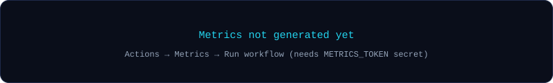

<!-- ============================================================
  Profile README for playingkinggame
  Edit-me markers: search for "TODO" to find every placeholder.
============================================================ -->

  I'm a computer science student who builds with AI, writes a lot of Python, 
  and likes understanding how systems work from the model down to the machine.

## About me

- **Studying:** B.Tech in Computer Science Engineering, specialising in Artificial Intelligence and Machine Learning at **VIT Chennai** (2026–2030).
- **Fascinated by:** AI and ML, and how to turn them into software people can actually use.
- **Building:** real-world projects across full-stack development, Linux, DevOps, automation and cybersecurity.
- **Learning now:** Python and ML fundamentals, web development, and the tooling around shipping software.
- **Heading toward:** open-source contributions and a career as a highly skilled software engineer.

## Tech stack

Technologies I'm learning and building with, grouped by area. This is a list of interests, not a claim of expertise in each.
<!-- TODO: add or remove icons by editing the `i=` list. Names: https://skillicons.dev -->

<table>
  <tr>
    <td width="170"><b>Languages</b></td>
    <td></td>
  </tr>
  <tr>
    <td><b>Frontend</b></td>
    <td></td>
  </tr>
  <tr>
    <td><b>Backend</b></td>
    <td> &nbsp;+ REST APIs</td>
  </tr>
  <tr>
    <td><b>AI / ML</b></td>
    <td></td>
  </tr>
  <tr>
    <td><b>Tools & platforms</b></td>
    <td></td>
  </tr>
</table>

## Featured projects

<!-- TODO: replace each "Repository: coming soon" with the real URL once the repo exists.
     TODO: confirm the stack icons and status for each project; they are suggestions. -->

<table>
  <tr>
    <td width="50%" valign="top">
      <h3>NetSentinel AI</h3>
      
AI-powered network intrusion detection dashboard.

       
      <b>Status:</b> TODO &nbsp;·&nbsp; <b>Repository:</b> coming soon
    </td>
    <td width="50%" valign="top">
      <h3>RepoPilot</h3>
      
AI-powered GitHub repository analysis and management.

       
      <b>Status:</b> TODO &nbsp;·&nbsp; <b>Repository:</b> coming soon
    </td>
  </tr>
  <tr>
    <td valign="top">
      <h3>SecureRemote</h3>
      
Remote control system for managing a Windows computer from a phone.

       
      <b>Status:</b> TODO &nbsp;·&nbsp; <b>Repository:</b> coming soon
    </td>
    <td valign="top">
      <h3>Project ECHO</h3>
      
AI-powered chat draft generation assistant.

       
      <b>Status:</b> TODO &nbsp;·&nbsp; <b>Repository:</b> coming soon
    </td>
  </tr>
  <tr>
    <td valign="top">
      <h3>PrivateDrop</h3>
      
Personal device-to-device file transfer platform.

       
      <b>Status:</b> TODO &nbsp;·&nbsp; <b>Repository:</b> coming soon
    </td>
    <td valign="top">
      <h3>Your next project</h3>
      
Pin your best repositories on your profile to show them here automatically.

      <a href="https://github.com/playingkinggame?tab=repositories">Browse all repositories</a>
    </td>
  </tr>
</table>

## GitHub activity

All figures below are generated live from my GitHub account. If a card fails to load, its description appears instead and it will return on refresh.

<b>More cards: profile summary and self-hosted metrics</b>

 

  

## Contribution snake

<picture>
  <source media="(prefers-color-scheme: dark)" srcset="https://raw.githubusercontent.com/playingkinggame/playingkinggame/output/github-snake-dark.svg">
  <source media="(prefers-color-scheme: light)" srcset="https://raw.githubusercontent.com/playingkinggame/playingkinggame/output/github-snake.svg">
  
</picture>

## Trophies

<!-- Trophies fill in as you earn them, so an early profile may show few or none. -->

## Connect

<!-- TODO: replace YOUR-LINKEDIN, YOUR-PORTFOLIO and YOUR-EMAIL. Delete any badge you don't want. -->

  
Always learning, always building.

